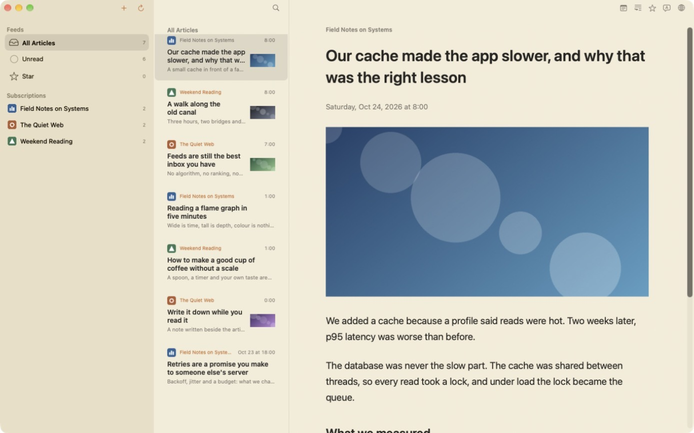
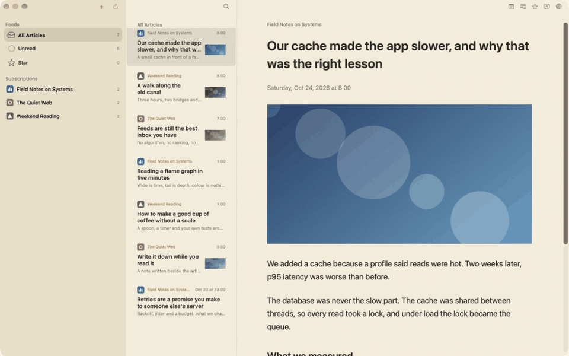
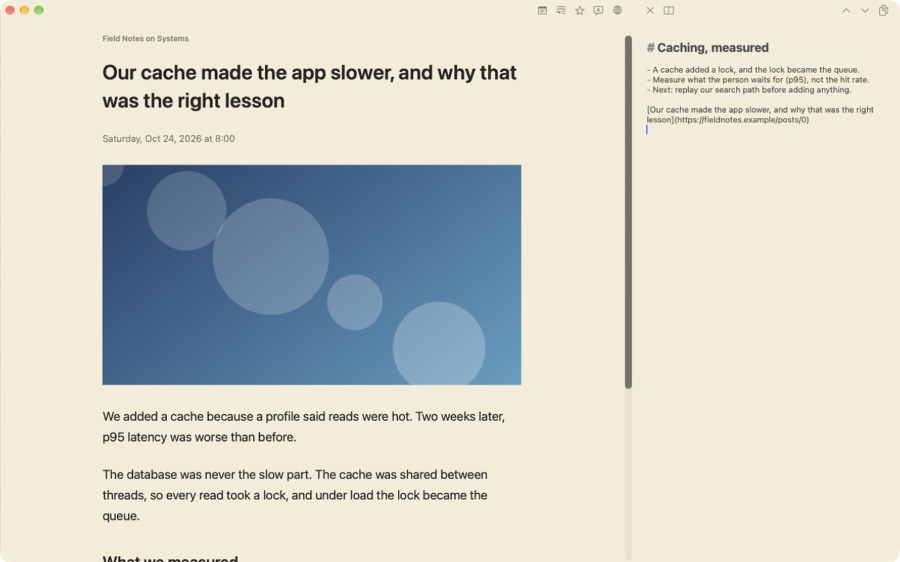

<div align="center">


# Unagi Reader

**An RSS reader for the Mac with a note beside every article.**<br />
Read fast with the keyboard, write what you understood in your own words, and keep all of it on your Mac.

[](https://github.com/ojiman/unagi-reader/releases/latest)

[](LICENSE)
[](https://github.com/ojiman/unagi-reader/actions/workflows/ci.yml?query=branch%3Amain)
[](https://github.com/ojiman/unagi-reader/actions/workflows/codeql.yml?query=branch%3Amain)

**[Download](https://github.com/ojiman/unagi-reader/releases/latest)** · [Features](#features) · [Install](#install) · [FAQ](#faq) · [Contributing](#contributing)

</div>

> [!IMPORTANT]
> Get Unagi Reader only from this repository's [Releases](https://github.com/ojiman/unagi-reader/releases). [Install](#install) shows how to check that a download is the one this repository built.

<p align="center">
  
</p>

## Why Unagi Reader

More is written every day than anyone can read. Finding the few articles that matter is one problem; turning them into something you understand is another. Most readers stop at "read" and "starred", and moving to a notes app or an AI chat breaks the flow.

Unagi Reader keeps one loop in one window: **read → note → understand.** Press `n` and a plain Markdown note opens beside the article. Press `i` and the article's link, or the passage you selected, goes into the note. What stays is your own note, in your own words.

**No account. No server. Your data stays on your Mac.** Your subscriptions, what you have read and your note are saved only on your Mac. There is no sign-up, no server of ours and no tracking.

<p align="center">
  
</p>

## Features

| | |
|---|---|
| **Keyboard first** | `j` / `k` to move, `m` read or unread, `s` Star, `/` to narrow the list. Scrolling and typing never wait on a refresh or the network. |
| **A note beside the article** | One plain Markdown note, one key away. Headings and lists are styled as you type; the saved text stays exactly what you typed. |
| **Send to the note** | `i` adds the article's title and link, or the selected passage as a quotation with its link, where you are writing. |
| **Bring your own AI, if you want** | The app has no AI of its own. **Copy Markdown** copies the note so you can paste it into any AI you choose, or use the system's Writing Tools. |
| **Translate on your Mac** | `t` translates the open article with macOS's own translation; the text does not leave your Mac. |
| **Subscriptions** | Add a feed or a site address, folders, OPML import and export. Refreshes every 30 minutes. |
| **Comfortable to read** | Light, dark and sepia, five text sizes, the feed's own images and formatting. `v` opens the original page inside the app, `b` in your browser. |
| **Your language** | The interface is in English, Japanese, Simplified Chinese, Traditional Chinese, Korean, Spanish and Brazilian Portuguese. |

All keys and settings are in the [user guide](docs/user-guide.md).

<p align="center">
  
</p>

### Not in Unagi Reader, on purpose

Sync and accounts, an AI of its own, fetching full pages on its own, tags and goals. The app shows the text the feed gives, and the original page is one key away. Fewer things to manage keeps the loop fast. The reasons are in the [vision](docs/vision.md).

## Install

You need an Apple silicon Mac with macOS 27.0 or later.

1. Download `UnagiReader-<version>.dmg` from the [latest release](https://github.com/ojiman/unagi-reader/releases/latest).
2. Open it and drag **Unagi Reader** to **Applications**.
3. Open the app. macOS stops it the first time with a message that it could not check the app. Open **System Settings ▸ Privacy & Security**, find the message about Unagi Reader and choose **Open Anyway**.

**Why macOS warns.** Apple accepts an app without this warning only if it is signed with a paid Developer ID and notarized. Unagi Reader is a free project by one person and does not use one, so macOS shows the warning again after each update. Do not turn Gatekeeper off for it; **Open Anyway** is enough.

**Check that your download is genuine.** GitHub Actions builds every DMG from a tagged commit of this repository; nothing is built or uploaded by hand. With the [GitHub CLI](https://cli.github.com/):

```sh
gh attestation verify UnagiReader-<version>.dmg --repo ojiman/unagi-reader
```

Or compare `shasum -a 256 UnagiReader-<version>.dmg` with the SHA-256 in the release notes.

**Update** by downloading the new DMG and replacing the app. Your library is kept.

<details>
<summary>Build from source</summary>

You need the Swift toolchain from Xcode.

```sh
git clone https://github.com/ojiman/unagi-reader.git
cd unagi-reader
bash scripts/build-app.sh release
open '.build/Unagi Reader.app'
```

To look around with demo subscriptions and without touching your library, see [the user guide](docs/user-guide.md#1-start-the-app).

</details>

## FAQ

**Does it send my data anywhere?**
No. The app connects only to the sites you subscribe to (for feeds, images and icons) and to the original pages you open. The first translation into a language may make macOS download that language from Apple. Writing Tools are part of macOS and follow Apple's settings.

**Will an update keep my library?**
Yes. From 1.0, an update keeps your subscriptions, read state, Stars and note. The library is in `~/Library/Application Support/UnagiReader/`.

**Why does macOS warn when I open it?**
The app is not notarized, because that needs a paid Developer ID. [Install](#install) explains how to open it and how to check the download.

## Contributing

Issues and pull requests are welcome.

- **Found a bug or have an idea?** [Open an issue](https://github.com/ojiman/unagi-reader/issues/new/choose).
- **Speak Chinese, Korean, Spanish or Portuguese?** Those translations were prepared with AI and no person has reviewed them yet. Open an issue with the language, the screen, the current wording and a better one, or send a pull request to `Sources/ReaderCore/Resources/Localizable.xcstrings`.
- **Want to write code?** Start with an issue labelled [good first issue](https://github.com/ojiman/unagi-reader/labels/good%20first%20issue), or open an issue to talk about a change first. [AGENTS.md](AGENTS.md) has the commands, the checks and how work is tracked. Tests use only synthetic feeds and temporary libraries.

| Document | What it is |
|---|---|
| [User guide](docs/user-guide.md) | Every key and setting, backup, using the note with an AI |
| [Vision](docs/vision.md) | What the app is for, its promises, and what it will not do |
| [Specification](docs/specification.md) | What the app does, rule by rule |
| [Architecture](docs/architecture.md) | How it is built |
| [Roadmap](docs/roadmap.md) | What comes next |
| [Decision records](docs/decisions/README.md) | Why things are the way they are |

## Security

Please report a vulnerability privately, as the [security policy](SECURITY.md) explains; do not open a public issue.

CodeQL scans the Swift, Python and GitHub Actions code: Python and Actions on every pull request, Swift on `main` and every week. Dependabot checks the dependencies and opens update pull requests every week. Secret scanning and push protection help detect committed credentials and block pushes that contain them. A passing scan does not prove the app has no vulnerabilities; the trust boundaries are in the [architecture](docs/architecture.md#2-input-from-the-network-is-untrusted).

## License

[Apache License 2.0](LICENSE). Third-party notices are in [ThirdPartyNotices.md](ThirdPartyNotices.md). Feed content, original pages and site icons belong to their owners. The screenshots show synthetic demo feeds.
